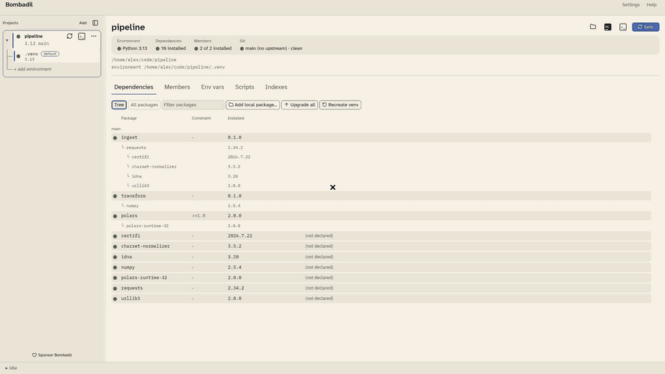

<p align="center">
  
</p>

<p align="center">
  <a href="https://github.com/marcelotrevisani/bombadil/actions"></a>
  
  
  
  <a href="https://github.com/sponsors/marcelotrevisani"></a>
</p>

---

**Documentation: <https://marcelotrevisani.github.io/bombadil/>**

A desktop application for the Python virtual environments you already have.
Bombadil keeps an account of them — which exist, which have drifted from what
their manifest declares, what is installed in each — and gives you one place to
sync, inspect and open them.

It never owns an environment. `uv` creates them, `uv` resolves them, and
Bombadil is the thing that tells you the truth about them and gets out of the
way. Delete Bombadil and every environment it showed you is still there,
untouched.

> *"Bright blue his jacket was, and his boots were yellow."*
> Tom Bombadil is the keeper of a bounded domain who owns nothing he tends.
> That is the whole design brief, and it is where the palette comes from.

<p align="center">
  <a href="docs/images/demo.mp4"></a>
  <br>
  <em>Adding a project, then opening a terminal and PyCharm with its environment activated. Click for the full two-minute video, which also adds a second environment and a variable.</em>
</p>

## What it does

**Projects and environments.** Register a project by its `pyproject.toml`. A
project can carry several environments — a 3.11 and a 3.12, say — shown as a
tree beneath it, with one marked default: the one Sync, the terminal and the
dependency view act on. An environment can live beside the project or anywhere
else on disk, including one another project already uses.

**One glyph vocabulary, everywhere.** Every row in every pane — projects,
dependencies, workspace members, indexes — reports state the same way, and no
two states ever look alike:

| | | |
|---|---|---|
| ● | **present** | it exists and matches |
| ○ | **absent** | declared, not installed |
| ◍ | **drifted** | installed, but not what was asked for |

**Sync, with the output.** `uv sync` streams into a drawer that follows the
output and stays where you put it. A failure shows the transcript rather than a
shrug.

**Dependencies and workspace members.** What the manifest declares against what
is actually installed, joined on PEP 503-canonical names so `calc_service` and
`calc-service` are one row. Monorepo members are listed with what a sync would
add or remove before you run it.

**Environment variables and secrets.** Global variables and per-project ones,
with the project's overriding. Mark a variable secret and its value moves to the
OS keychain — it is never written to `config.toml`, never carried in a message,
and never read back to be redisplayed.

**Private indexes.** Name, URL, and credentials in the keychain, injected as
`UV_INDEX_*` at sync time. Global by default, selectable per project.

**Pre-activate scripts.** Shell scripts run before an environment is used, in an
order you control, with their exported variables composed into everything
Bombadil launches.

**Terminals and PyCharm.** Open a terminal in the project directory with the
environment activated — every emulator's argv is built for the platform, and the
app knows which ones cannot carry an environment rather than pretending. The
PyCharm button sets the environment as the project's interpreter and opens the
project folder with the same composed environment. PyCharm is detected, or
chosen in Settings.

**Pinned interpreters, safely.** `uv sync -p X` against an environment built on
another version **deletes it**. Bombadil compares pins segment-wise against what
`pyvenv.cfg` actually records, so `3.12.13` and `3.12` are not treated as a
conflict, and a genuinely destructive pin change asks first.

**Pull request checks.** A project on a branch with an open GitHub pull request
shows it in the GitHub tab, with every check run and links to the PR and the
runs. You are notified when its checks start and finish. It uses `gh` when it
is signed in, or a read-only token kept in the keychain.

## Install

Bombadil bundles `uv 0.13.1`, so there is nothing else to install. By default it
uses `uv` from `PATH` when that is at least `0.12.1` and falls back to the
bundled copy; you can force either.

Each [release](https://github.com/marcelotrevisani/bombadil/releases/latest)
has installers: a `.deb` and an `.rpm` for Linux (x86-64 and ARM), a
universal `.dmg` for macOS and a setup `.exe` for Windows. Or install from a
package registry:

```sh
pip install bombadil     # or: uv tool install bombadil
cargo install bombadil
```

Either gets you the same application. The wheel carries the compiled binary and
a console entry point and contains no Python at all — the route `uv` itself
takes to PyPI — so `bombadil` lands on your PATH the same way.

Wheels are built for Linux (x86-64 and ARM), macOS on Apple Silicon, and
Windows. An Intel Mac has no prebuilt wheel; `cargo install bombadil` builds
there from source. `bombadil` is a meta crate: it owns the name
worth typing and pulls in `bombadil-gui`, `bombadil-core` and `bombadil-uv-bin`
behind it. It has to be a real binary rather than an alias, because
`cargo install` installs binaries defined *in* the package being installed and
never in its dependencies.

From a checkout instead:

```sh
git clone https://github.com/marcelotrevisani/bombadil
cd bombadil
just run-release          # or: cargo run --release -p bombadil
```

Rust 1.88 or newer, edition 2024. The build downloads the pinned `uv` release
for your platform.

Configuration lives at `~/.config/bombadil/config.toml` on Linux,
`~/Library/Application Support/bombadil/` on macOS, and
`%APPDATA%\bombadil\config\` on Windows. Secrets live in the OS keychain, never
in that file.

## Development

```sh
just            # list every recipe
just run        # debug build
just test       # workspace tests
just ci         # fmt-check, clippy, test, cargo-deny, msrv -- what CI runs
just icon       # regenerate assets/ from the SVGs there (needs cairosvg)
```

On Linux, `just install-desktop` puts a desktop entry and the themed icons in
`~/.local/share` (per-user, no root; `just uninstall-desktop` removes exactly
those). This is not decoration: **GNOME on Wayland ignores the icon a window
carries.** It resolves a window's icon by matching its `app_id` to the basename
of an installed `.desktop` file and reading that file's `Icon=` key out of the
icon theme, so without the entry the panel shows a generic placeholder no
matter what the binary holds. X11, Windows and macOS use the compiled-in icon,
which is why it is set both ways.

808 tests across three crates, green on Linux, macOS and Windows.

### Conventions worth knowing before you patch it

- **`view` is dumb and untested.** Logic worth a test lives in a free function
  that `view` calls. A change that only exists inside `view` ships without a
  test, and its commit says so.
- **A fix needs a mutation proof.** Break the fix on purpose and watch a test
  fail. Seventeen tests in this repo's history passed for the wrong reason; one
  was in a *test double* that could not tell `spawn` from `run`, so every test
  on that seam inherited the blind spot.
- **Never compare a `display()`ed path to a string literal.** `PathBuf::join`
  uses `\` on Windows. Three CI failures here came from a platform assumption
  hiding in an assertion rather than in the code.
- **Secrets never enter a `Message`** — it derives `Debug` — and never reach a
  `ConfigPersist`.
- **Runners, secret stores, persisters and filesystem probes are parameters**,
  never constructed inline, so tests stay hermetic and no test can reach the
  real keychain.
- **`BOOT` is rationed.** The attention colour appears only where the user must
  look. If it starts appearing elsewhere it stops meaning anything, and the
  test that guards this is the most important one in `theme`.
- **Never edit `deny.toml` to dodge a licence or advisory failure.** Escalate.

### Releasing

Publishing is irreversible — crates.io versions can be yanked but never
replaced, and a yanked version still resolves for anything that already has it
in a lock file. So the pipeline gates everything before it uploads anything, and
can be rehearsed:

1. Run **Release** from the Actions tab with `dry_run` left on. It packages and
   verifies all three crates and uploads nothing.
2. Bump `version` in the workspace `Cargo.toml`, commit, and tag it `vX.Y.Z`.
   The tag and the manifest must agree — the pipeline refuses otherwise, because
   a mismatch is silent and neither half can be taken back.
3. Push the tag. It re-runs the full CI set against that exact commit, builds
   each crate from its own packaged tarball, then publishes
   `bombadil-core` → `bombadil-uv-bin` → `bombadil-gui` → `bombadil` in dependency
   order, uploads one wheel per platform to PyPI, and opens a GitHub release.

crates.io and PyPI are published by separate jobs with separate tokens
(`RELEASE_TOKEN`, `PYPI_BOMBADIL`), so failing to reach one never leaves the
other half-done.

The crates.io token is `RELEASE_TOKEN` on the `crates_deploy` environment, so
nothing outside the publish job can read it.

## Crates

| Crate | What it is |
|---|---|
| `bombadil` | The binary. Install this one; it brings the rest. |
| `bombadil-gui` | The iced front end, as a library with one public function. |
| `bombadil-core` | Model, config store, uv invocation, environment composition, keychain, terminals, IDE launch. No GUI. |
| `bombadil-uv-bin` | Fetches and embeds the pinned `uv` binary at build time. |

## Sponsor

If Bombadil saves you time, please consider [sponsoring its development on GitHub](https://github.com/sponsors/marcelotrevisani).
The **Sponsor Bombadil** button at the foot of the app's sidebar opens the same page.

## Licence

Apache-2.0. See [LICENSE](LICENSE).

Bombadil ships `uv` (Apache-2.0 / MIT), `just` (CC0 1.0), Atkinson Hyperlegible Next and IBM Plex
Mono (both SIL OFL 1.1). Every licence text is in the application itself, under
**Help → Bundled licences**, as those licences require.
