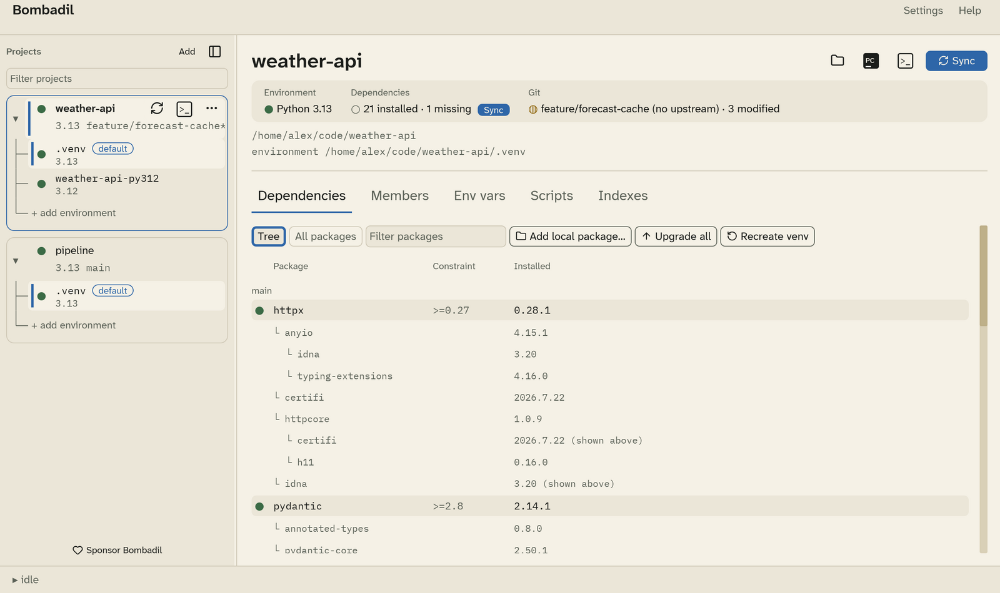
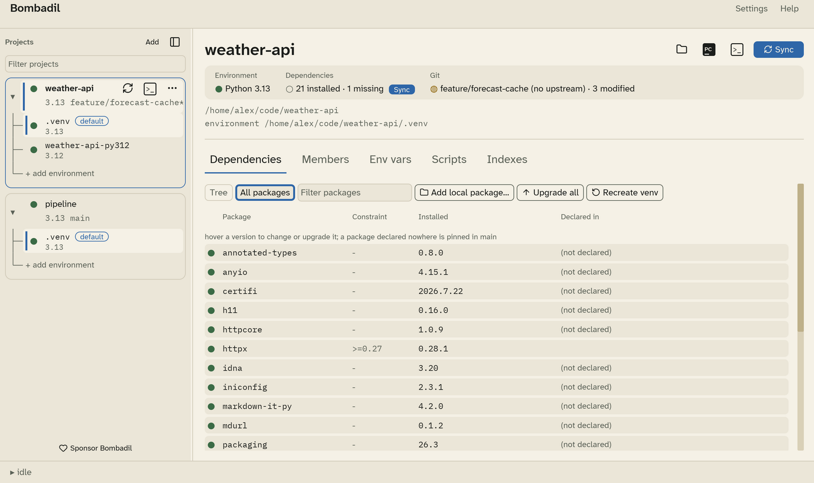
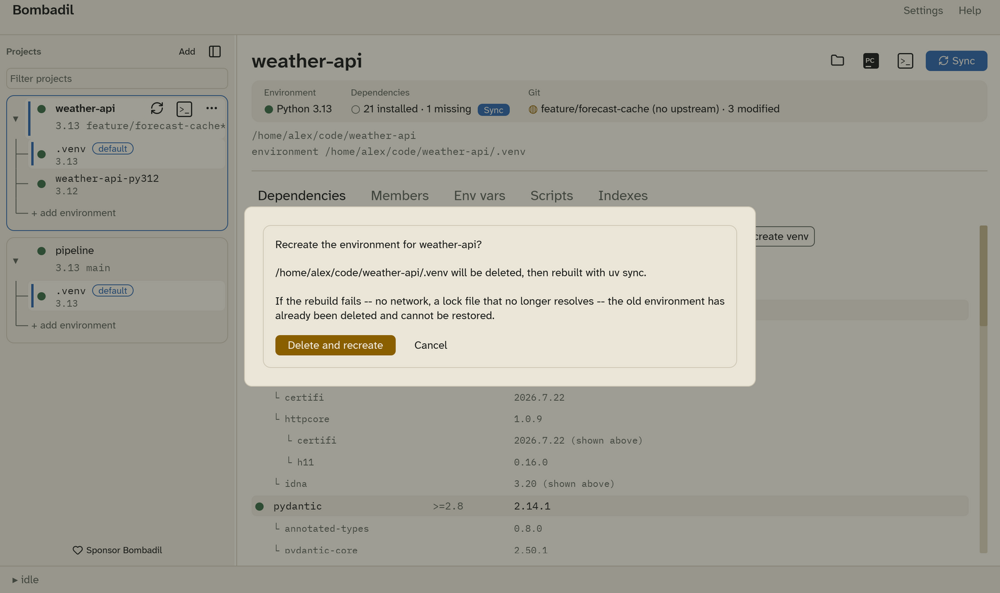

# Dependencies and sync

The **Dependencies** tab compares what `pyproject.toml` declares with what is
installed in the project's default environment. Package names are
matched after normalisation, so `calc_service` and `calc-service` are the same
package.

## Tree view



**Tree** lists each declared dependency under its group: `main`, then every
dependency group (`dev`, …) and every optional extra. Under each dependency is
the resolved tree of what it pulls in.

| Column | Meaning |
|---|---|
| **Package** | The package, with its status mark. |
| **Constraint** | The version range declared in `pyproject.toml`. |
| **Installed** | The version installed in the environment. A package that already appears elsewhere in the tree is marked *(shown above)*. |

A package declared in two groups appears under both.

## All packages



**All packages** lists every installed package once, alphabetically, including
the transitive ones. **Declared in** shows which group declares it, or
*(not declared)* for a package that is only there because something else
needs it.

## Filtering

Type in **Filter packages** to narrow either view. The shortcut is
++ctrl+f++.

## Package details

Click a package's name to open its details under the row; click it again to
close them. The details show:

- **What it is**: the package's own description, homepage and licence, read
  from the files installed with it.
- **Why it's installed**: "Declared in main" for a package you asked for, or
  the chain that pulled it in, such as "Needed by fastapi → starlette".
- **Versions**: installed, declared, and the newest release when Bombadil has
  checked for newer versions.
- **Known vulnerabilities**, when it has any (below).

In the tree view, only the packages you declared have details. Use **All
packages** for the ones they pull in.

## Known vulnerabilities

When the Dependencies tab loads and after each sync, Bombadil asks
[osv.dev](https://osv.dev), a free database of security advisories, whether
any installed package has a known vulnerability. It sends package names and
versions, nothing else, and asks again only when the installed packages
change, or after a day.

A package with a known vulnerability has a **!** beside its name, and the
project shows a warning such as "2 packages have known vulnerabilities". Open
the package's details to read each advisory; click its id to read more.
**Upgrade to …** installs the one version that fixes every advisory with a
published fix, and says how many that is. An advisory with no fix yet says
so. Bombadil also sends nothing about your own projects or workspace members,
only published packages.

Without an internet connection the check is skipped, and the tab says
"Couldn't check for vulnerabilities". To stop the check altogether, untick it
in [Settings › Environments](settings.md#environments).

## What changed

After a sync, an upgrade, a version change or adding a package, the
confirmation names what changed, for example "Synced api: numpy 2.1.0 →
2.3.1, added polars, removed six". The output drawer lists every change, one
per line:

```
↑ numpy 2.1.0 → 2.3.1
+ polars 1.9.0
- six 1.16.0
```

`↓` marks a downgrade. The Dependencies tab keeps the summary as **Last
change** until you select another project.

## Changing a version

Hover an installed version to show its actions:

- **Change version**: type a version, such as `2.31.0`, and press
  ++enter++. You can also double-click the version. Bombadil runs
  `uv add name==version` in the group that declares the package, then syncs.
  A package that no group declares is pinned in `main`.
- **Upgrade within its constraint**: locks the newest version the declared
  constraint allows (`uv lock --upgrade-package`), then syncs.

**Upgrade all** upgrades every package to the newest versions their
constraints allow. It asks first, because it rewrites much of `uv.lock`.

## Adding a local package

**Add local package…** asks for a folder that contains a `pyproject.toml` or
`setup.py`. Then you choose:

- **Which group** gets the package: `main`, a dependency group, or an extra.
- **Editable**: if checked, changes in the folder apply without reinstalling.

Bombadil runs `uv add` with a path relative to the project, so the
`pyproject.toml` stays valid for your teammates.

## Recreate venv

**Recreate venv** deletes the default environment and builds it again with
`uv sync`. Use it when an environment is broken beyond what a sync can fix.



!!! warning
    The old environment is deleted **before** the rebuild starts. If the
    rebuild fails, for example because there is no network or the lock file
    no longer resolves, the old environment can't be restored.

## When a sync changes the Python version

If an environment's Python pin no longer matches the Python it was built
with, `uv sync` has to delete the environment and build it again. Bombadil
compares versions segment by segment, so `3.12` matches `3.12.13`. It only
asks for confirmation when the change really would rebuild. See
[Gotchas](gotchas.md#changing-the-python-version-deletes-the-environment).
