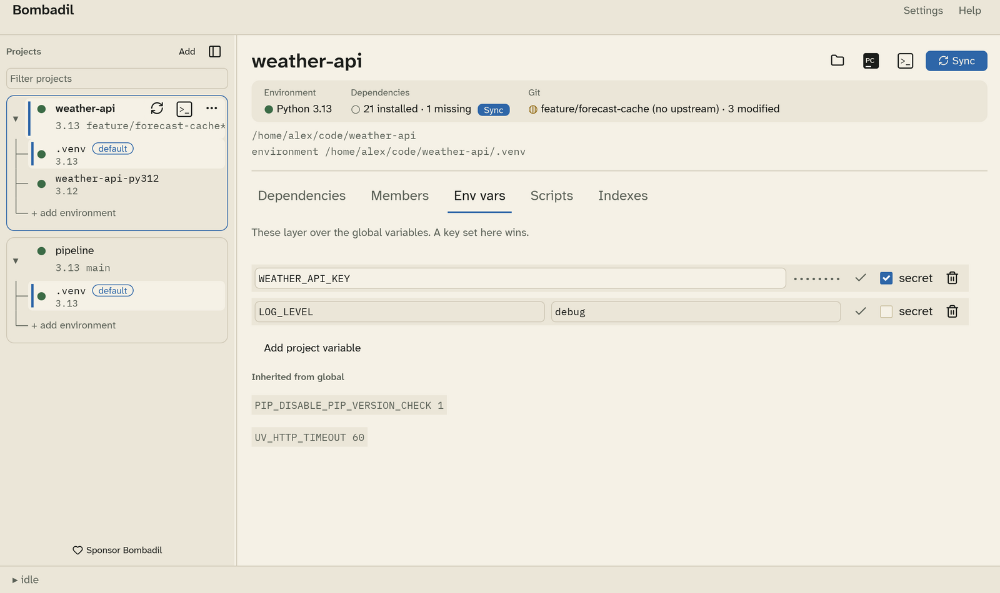

# Environment variables and secrets

Bombadil composes an environment for everything it launches: uv commands,
terminals, PyCharm and pre-activate scripts. You can add your own variables
to it.

## Global and project variables

- **Global variables** apply to every project. Set them in
  [Settings › Env vars](settings.md#env-vars) with the **Global** scope.
- **Project variables** apply to one project. Set them in the project's
  **Env vars** tab, or in Settings with that project's scope.

When both set the same key, the project's value wins. The project tab lists
the global variables under **Inherited from global**, and marks the ones the
project overrides.

To add a variable, click **Add project variable** (or **Add global
variable**). Type the key and value, then press ++enter++ or click ✓ to save
it. If you leave the tab with values not saved yet, Bombadil tells you how
many are pending.

## Secrets

Tick **secret** to keep a value in your operating system's keychain instead
of the config file:

- macOS: Keychain
- Windows: Credential Manager
- Linux: the Secret Service (GNOME Keyring, KWallet, …)

A secret's value is never written to `config.toml`, never shown again after
you save it, and redacted as `***` in any error output. To change a secret,
type a new value and save it.

!!! note
    On Linux, secrets need a running Secret Service. See
    [Gotchas](gotchas.md#secrets-need-a-keyring-on-linux).

## What a launched process sees

The layers below are applied in order, and each one overrides the ones
before it:

1. The environment Bombadil itself was started with.
2. Global variables.
3. Project variables.
4. Secrets.
5. Package index settings (`UV_INDEX`, `UV_DEFAULT_INDEX` and credentials).
6. [Pre-activate scripts](scripts.md).
7. Activation: `VIRTUAL_ENV`, `UV_PROJECT_ENVIRONMENT`, and the environment's
   `bin` (or `Scripts` on Windows) at the front of `PATH`.

Activation always comes last, so a script can't point uv at one environment
while your shell uses another.
