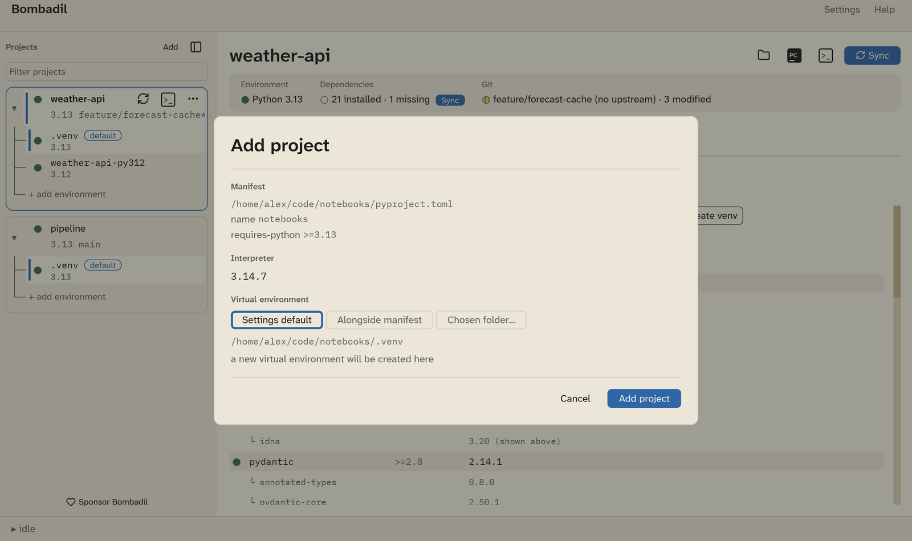
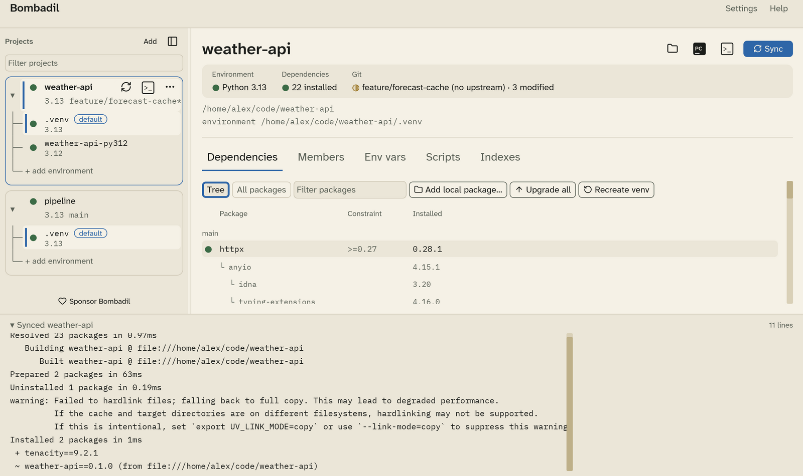

# Getting started

This walks through adding a project, syncing it, and opening it.

## Start a new project

To start from nothing, click **New** at the top of the sidebar (or **New
project** when the list is empty). Give the project a name, choose where it
goes, and pick:

- **App**: something you run. It gets a button on the [Run](running.md) tab.
- **Library**: something other code imports.

You can also choose a Python version and whether to start a Git repository.
**Create** makes the folder with `uv init`, then opens the **Add project**
dialog below on it, so you choose where its environment lives.

## 1. Add a project

Click **Add** at the top of the sidebar, or press ++ctrl+n++
(++cmd+n++ on macOS), and choose a folder. Bombadil looks for
`pyproject.toml` in that folder and its subfolders:

- If it finds one, the **Add project** dialog opens.
- If it finds several, as in a monorepo, it lists them so you can pick one.
- If every project it finds is already in Bombadil, it says so.

You can also drag a folder or a `pyproject.toml` onto the window.

The dialog shows:

- **Manifest**: the `pyproject.toml`, the project name, and its
  `requires-python`.
- **Interpreter**: the installed Python that the new environment will use. If
  no installed Python satisfies `requires-python`, the dialog offers to
  install one with uv.
- **Virtual environment**: where the environment lives.
    - **Settings default** follows the global setting (see
      [Settings › Environments](settings.md#environments)).
    - **Alongside manifest** uses `<project>/.venv`.
    - **Chosen folder…** uses any folder you pick.

The line under the choices tells you what happens next. Either a new
environment will be created, or an existing one will be adopted as it is.

Click **Add project**. Bombadil saves the project and runs its first
`uv sync`.

## 2. Read the overview

Select the project in the sidebar. The header shows three tiles:

| Tile | Shows |
|---|---|
| **Environment** | The Python version of the default environment. |
| **Dependencies** | How many packages are installed and how many are missing. A **Sync** badge appears when a sync would change something. |
| **Git** | The branch, its upstream, and how many files are modified. |

Each status uses the same three marks everywhere in the app:

| Mark | Meaning |
|---|---|
| ● | **Present.** It exists and matches what was asked for. |
| ○ | **Absent.** Declared, but not installed. |
| ◍ | **Drifted.** Installed, but not what was asked for. |

## 3. Sync

Click **Sync**, or press ++ctrl+enter++. Bombadil runs `uv sync` on the
project's default environment and streams the output into the drawer at the
bottom of the window.

## 4. Open it

The buttons at the top right of a project are, from left to right:

- **Folder**: opens the project folder in your file manager.
- **PC**: opens the project in PyCharm, with the environment set as its
  interpreter. See [Terminals and PyCharm](terminals-pycharm.md).
- **>_**: opens a terminal in the project folder with the environment
  activated. The shortcut is ++ctrl+t++.
- **Sync**: runs `uv sync`, as in step 3.

## Next steps

- Give a project [more than one environment](main-window.md#environments).
- Add [environment variables and secrets](env-vars.md).
- Look through [Settings](settings.md).
