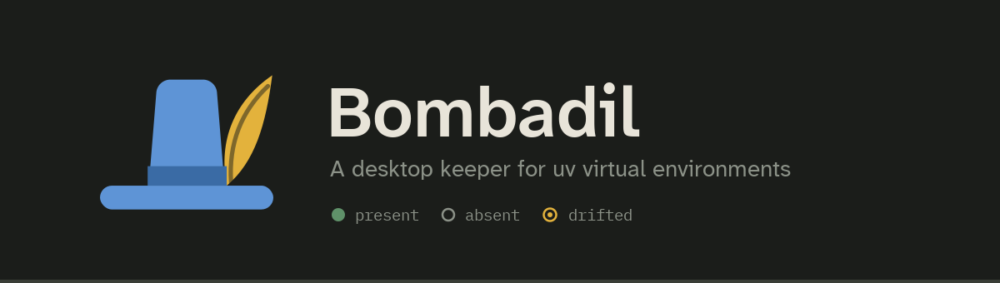

# Bombadil

Bombadil is a desktop app for the Python virtual environments you already
have. It shows which environments exist, which have drifted from what their
`pyproject.toml` declares, and what is installed in each. It also gives you one
place to sync them, look inside them, and open them in a terminal or PyCharm.

It never owns an environment. [uv](https://docs.astral.sh/uv/) creates them and
resolves them, and Bombadil reports on their state and runs uv for you. If you
uninstall Bombadil, every environment it showed you is still there, untouched.

<video controls muted playsinline preload="metadata" poster="images/main.png" style="width: 100%">
  <source src="images/demo.mp4" type="video/mp4">
</video>

Adding a project and a second environment, setting a variable, then opening a
terminal and PyCharm with the environment activated.

## What you can do with it

- Keep every project in one list. Each project shows its environments as a
  tree, with the default one marked. A project can have several environments,
  for example one on Python 3.12 and one on 3.13.
- See which packages, environments and workspace members are present, missing
  or drifted from what was declared.
- Run `uv sync` and watch its output stream into a drawer at the bottom of the
  window. If it fails, the full output stays there.
- Browse the resolved dependency tree, change a version, upgrade one package or
  all of them, or add a local package.
- In a monorepo, choose which workspace members are installed as editable
  packages.
- Set environment variables globally or per project. Secrets live in your OS
  keychain and are never written to the config file.
- Use private package indexes, with their credentials kept in the keychain.
- Open a terminal or PyCharm with the environment already activated.
- Close the window and keep Bombadil in the system tray, which has a menu for
  every project.

## Where to start

1. [Install Bombadil](install.md).
2. Follow [Getting started](getting-started.md) to add your first project.
3. Read [Gotchas](gotchas.md) before you change a Python version or point
   PyCharm at an environment.
