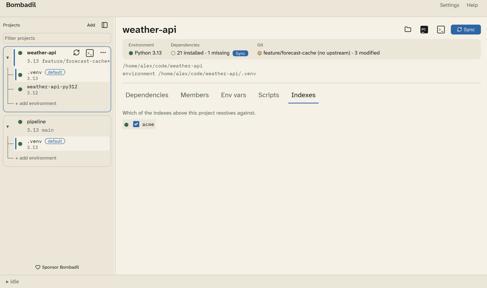

# Package indexes

Use private package indexes, such as a company registry or a mirror, with
their credentials kept in your OS keychain.

## Define an index

Indexes are defined once, globally, in
[Settings › Indexes](settings.md#indexes). Click **Add index** and fill in:

| Field | Meaning |
|---|---|
| **name** | Letters, digits, `-` and `_`. uv uses it in the credential variable names, for example `UV_INDEX_ACME_USERNAME`. |
| **url** | The index's simple-API URL, for example `https://pypi.acme.example/simple`. |
| **kind** | **replaces PyPI** (the default index) or **supplements PyPI** (an extra index). |
| **use for new projects** | Select this index automatically for projects added from now on. |
| **auth** | **none**, **basic** (a username and a password) or **token**. A token is sent as the password with the username `__token__`. |

Type the password or token in the credential field and click **save to
keychain**. The field is write-only: a saved credential is never shown again.

## Use an index in a project

In a project's **Indexes** tab, tick the indexes it should use.

When it runs uv, Bombadil passes the selected indexes as `UV_INDEX` or
`UV_DEFAULT_INDEX`, plus `UV_INDEX_<NAME>_USERNAME` and
`UV_INDEX_<NAME>_PASSWORD`. The same variables reach your terminals and
PyCharm, so `uv` commands you run there also authenticate.

!!! warning "Only one index can replace PyPI"
    uv accepts a single default index. If a project selects two indexes set
    to **replaces PyPI**, the last one wins.

!!! warning "Names that collide"
    uv uppercases index names and turns `-` into `_`, so `my-index` and
    `my_index` map to the same credential variables. Bombadil refuses to send
    credentials when two selected indexes collide like this.
