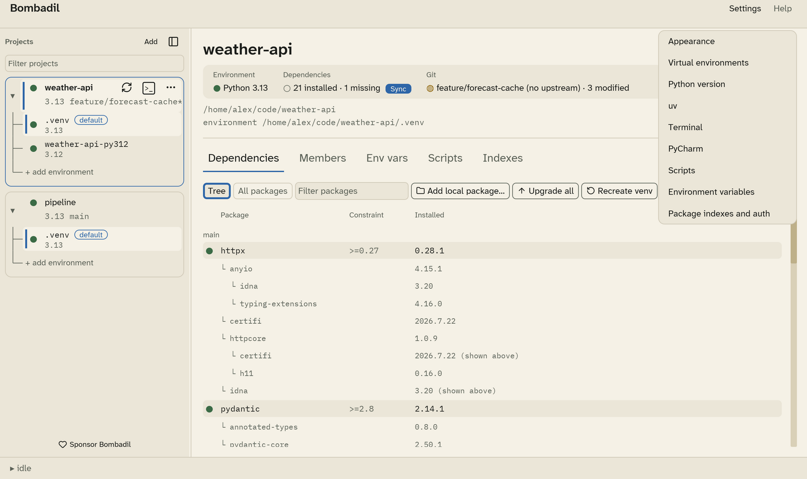
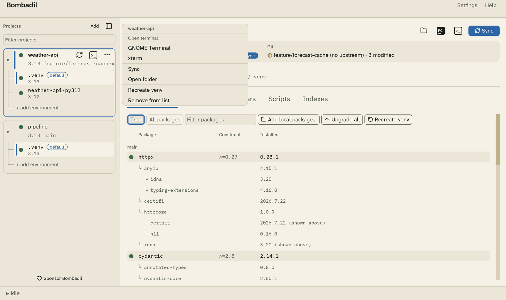
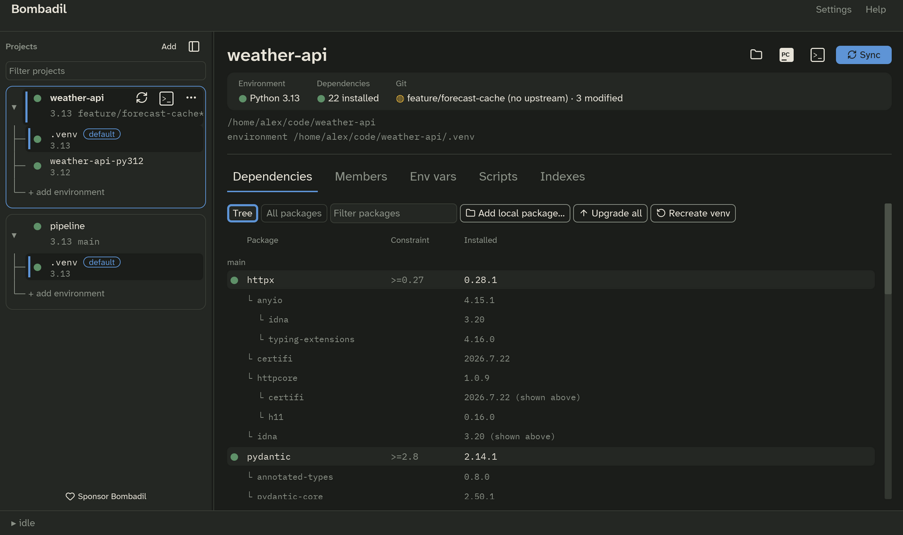

# The main window

The window has four parts: the menu bar at the top, the **sidebar** on the
left, the **project view** on the right, and the **drawer** along the bottom.

## Menu bar

- **Settings** opens [Preferences](settings.md) at any of its sections.
- **Help** has **Keyboard shortcuts**, **About Bombadil** and **Bundled
  licences**.

## Sidebar

The sidebar lists your projects. Each project is a card. Its first line shows
the status mark and name. The second line shows the Python version and the Git
branch, with a `*` when the working tree has changes.

- **Filter projects** narrows the list as you type.
- **Add** adds a project.
- The panel button next to **Add** collapses the sidebar. The shortcut is
  ++ctrl+b++. Drag the sidebar's edge to resize it.
- Hover a project to show its **Sync**, **terminal** and **⋯** buttons.
- **⋯**, or right-clicking the project, opens the project menu.

The project menu has these items:

- **Open terminal** lists every terminal Bombadil knows on your OS.
- **Sync**
- **Open folder**
- **Recreate venv** deletes the environment and builds it again. It asks
  first.
- **Remove from list** removes the project from Bombadil. Nothing on disk is
  touched.

### Environments

Click the triangle next to a project to show or hide its environments. Each
environment row shows the folder name and the Python version. The default
environment is marked **default**.

- **Click an environment** to make it the default. Sync, the terminal, PyCharm
  and the Dependencies tab all act on the default environment.
- **+ add environment** asks for a folder and adds it as another environment
  of the project. Use this to keep, for example, a Python 3.12 environment
  next to a 3.13 one. You can also point at an environment that another
  project already uses.
- To set an environment's location or Python version, or to remove it, go to
  [Settings › Environments](settings.md#environments) and pick the project's
  scope.

## Project view

The project view has a header with the project's name, action buttons and
status tiles. Below that are the **path** of the project and of its default
environment, then five tabs. You can drag the tabs to reorder them.

| Tab | What it is for |
|---|---|
| [Dependencies](dependencies.md) | What is declared against what is installed. |
| [Members](members.md) | Workspace members to install as editable packages. |
| [Env vars](env-vars.md) | The project's environment variables and secrets. |
| [Scripts](scripts.md) | Shell scripts to run before the environment is used. |
| [Indexes](indexes.md) | Which private package indexes this project uses. |

## Drawer

The bar at the bottom shows what Bombadil is doing (**idle** when nothing is
running). Click it to open the drawer, which shows the output of the latest uv
command. It follows new output as it arrives, unless you scroll up.

## Notifications

Short messages, such as "Synced weather-api" or an error, appear as toasts and
go away on their own. When something fails, the full output stays in the
drawer.

## Light and dark

Bombadil follows your desktop's light or dark setting. You can also choose
one in [Settings › Appearance](settings.md#appearance).

