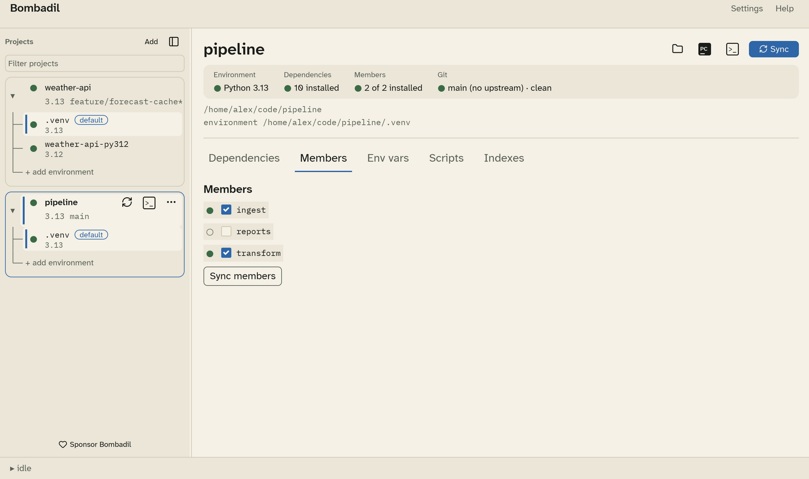

# Workspace members

For a monorepo, the **Members** tab lists every other `pyproject.toml` found
below the project, such as the packages of a
[uv workspace](https://docs.astral.sh/uv/concepts/projects/workspaces/).
Each member you select is installed into the environment in editable mode.

- Tick a member to install it, and untick it to stop installing it.
  Bombadil saves your selection in its own config. It never edits the
  workspace's `members` list in `pyproject.toml`, which belongs to your team.
- By default every discovered member is selected, so a package added to the
  repository later is installed without you doing anything. Only the members
  you untick are remembered.
- **Sync members** installs exactly the selected members (with
  `uv sync --package …`) and removes the rest from the environment. If that
  would remove something, Bombadil lists it and asks first.
- A folder whose `pyproject.toml` has no `[project].name` is listed but can't
  be installed.

The **Members** tile in the header counts how many of the selected members
are installed, for example "2 of 2 installed".
