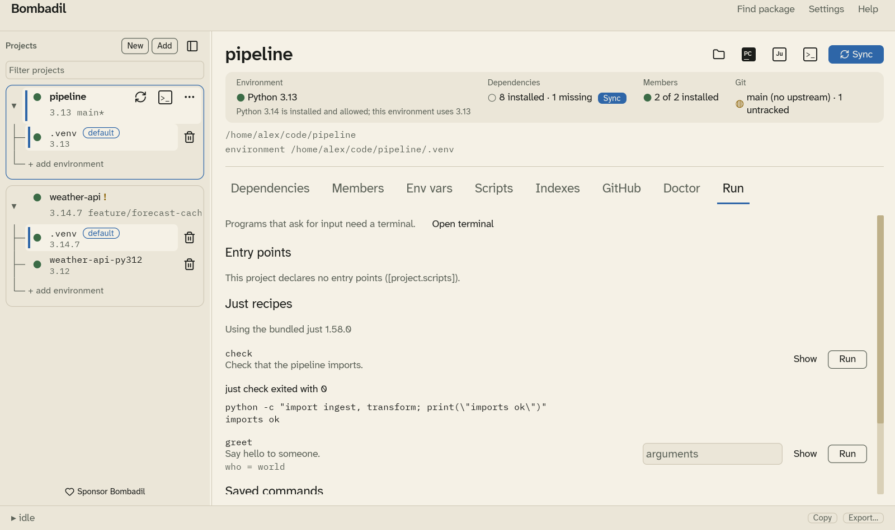

# Running code

The **Run** tab runs a project's code inside its default environment, with the
same environment variables, secrets and pre-activate scripts a terminal gets.
The output shows up right under the button you pressed, line by line as the
program prints it. The box grows with the output until it is a few hundred
pixels tall, then scrolls, keeping the newest line in view.

Each project can have one program running at a time. Other projects keep
working: you can sync one project while another runs a server.

A program can only start once the project has an environment. If it doesn't,
the buttons say **Sync first to create the environment.**

## Entry points

If the project's `pyproject.toml` has a `[project.scripts]` table, each name in
it gets a button. Pressing one runs `uv run <name>`. A project made with
**New project › App** has one from the start.

## Just recipes

If the project folder has a justfile (`justfile`, `Justfile` or `.justfile`),
its recipes are listed with the comment above each one and their parameters.
Private recipes (named with a leading `_`, or marked `[private]`) are left
out.

- **Show** opens the recipe's source under it, so you can read what it runs.
- **Run** runs `just <recipe>` inside the project's environment: `python`,
  `pytest` and the rest use the project's environment, with its variables,
  secrets and pre-activate scripts.
- A recipe with parameters has an **arguments** field. Type them as you
  would after `just <recipe>`; quotes group words. Run stays off until every
  parameter without a default has a value, and its tooltip says which.

Bombadil comes with its own copy of `just`, so you don't need to install it.
If you have `just` on your `PATH`, Bombadil uses yours instead; you can change
this in [Settings](settings.md#just). The line above the recipes says which
one is in use, for example "Using the bundled just 1.58.0" or "Using just from
PATH (/usr/bin/just)". If you pick **from PATH** and there is no `just` on
it, the tab says so and links to the install instructions.

If the justfile has a mistake, the tab shows just's own message. On Windows,
`just` runs recipes with `sh` unless the justfile sets `windows-shell`.

## Saved commands

Save the commands you run often, such as `pytest -q` or `python main.py`. Give
each a name (optional) and press **Add**. **Edit** loads a command back into
the form, and **Remove** deletes it. Saved commands are stored per project in
[`config.toml`](configuration.md).

A command is split into words on spaces. Put a word that contains spaces in
quotes: `pytest -k "not slow"`. Backslashes are kept as they are, so a Windows
path such as `python scripts\run.py` works.

## Run a file

**Run a file…** asks for a `.py` file and runs it with `python`. The file is
added to your saved commands, so it is one click the next time.

## Jupyter

The **Ju** button in the project header, next to PyCharm, starts JupyterLab
for the project and opens it in your browser. Bombadil switches to the Run
tab, where you'll find JupyterLab's output and **Stop**. JupyterLab runs from
a temporary install, so your project's dependencies and `uv.lock` don't
change.

## Stopping

**Stop** asks the program to finish, the same way closing a terminal window
does. If it hasn't ended after three seconds, Bombadil ends it. Anything the
program started, such as the Python process behind `uv run`, ends with it.

When a program ends, the tab says how: **exited with 0** means it finished
normally; any other number means it reported a problem, and the tab adds a
short explanation when it recognises one.

Bombadil asks before it would interrupt a program:

- **Sync** or **Recreate venv** on a running project asks **Stop the run and
  continue?** The sync starts once the program has stopped.
- **Quitting** asks first, then stops every running program.
- **Remove from list** stops the project's program.

## Programs that ask for input

A running program can't read from the keyboard here. If it waits for input,
use **Open terminal** instead.
