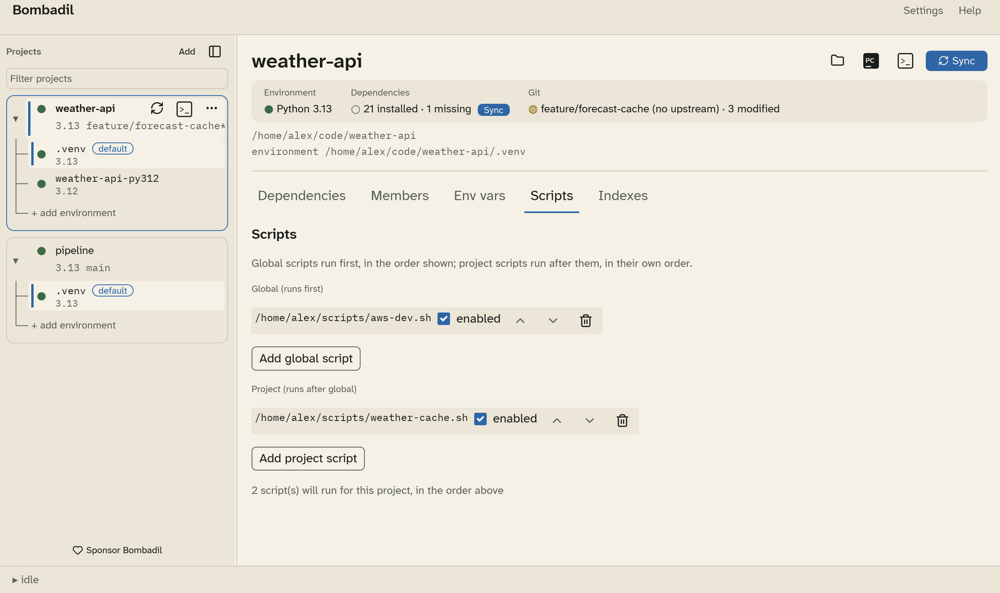

# Pre-activate scripts

A pre-activate script runs before an environment is used: before every uv
command, terminal and PyCharm launch. Every variable it exports becomes part
of the environment of whatever Bombadil starts next. Use one to log in to a
cloud profile, read a token from a vault, or set a cache directory.



## Order

- **Global scripts** run first, for every project. Manage them in
  [Settings › Scripts](settings.md#scripts).
- **Project scripts** run after the global ones. Manage them in the project's
  **Scripts** tab.

Inside each list, scripts run top to bottom. Use the arrows to reorder them,
untick **enabled** to skip one without removing it, and use the bin icon to
remove one. The line at the bottom says how many scripts will run for the
project.

## Writing a script

- **Linux and macOS**: the script is sourced by `sh`, not by bash or zsh, so
  write it in POSIX shell.
- **Windows**: the script is dot-sourced by PowerShell, so write a `.ps1`
  file.
- Only exported variables reach the environment. What the script prints is
  discarded.
- If the script exits with an error, the action stops and the error is shown,
  with any secret values replaced by `***`.

```sh
#!/bin/sh
# ~/scripts/aws-dev.sh
export AWS_PROFILE=dev
export AWS_REGION=eu-west-2
```

Scripts run after your variables and secrets, so they can read them. They
run before activation, so they can't change which environment is active.
See [What a launched process sees](env-vars.md#what-a-launched-process-sees).
