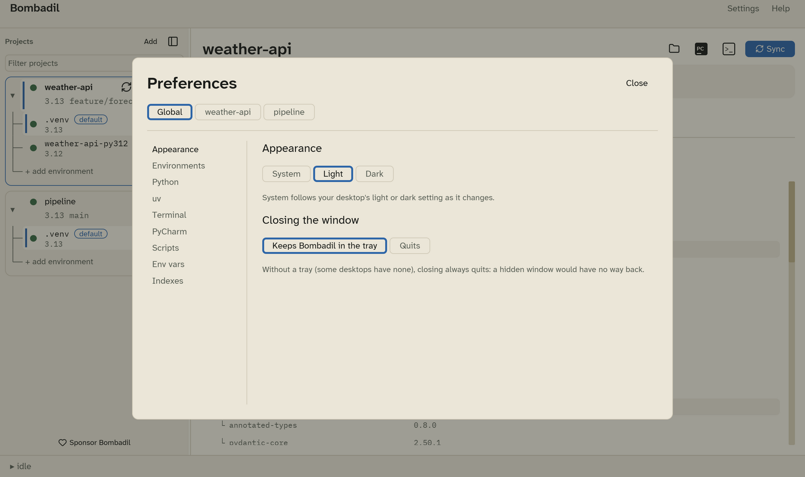
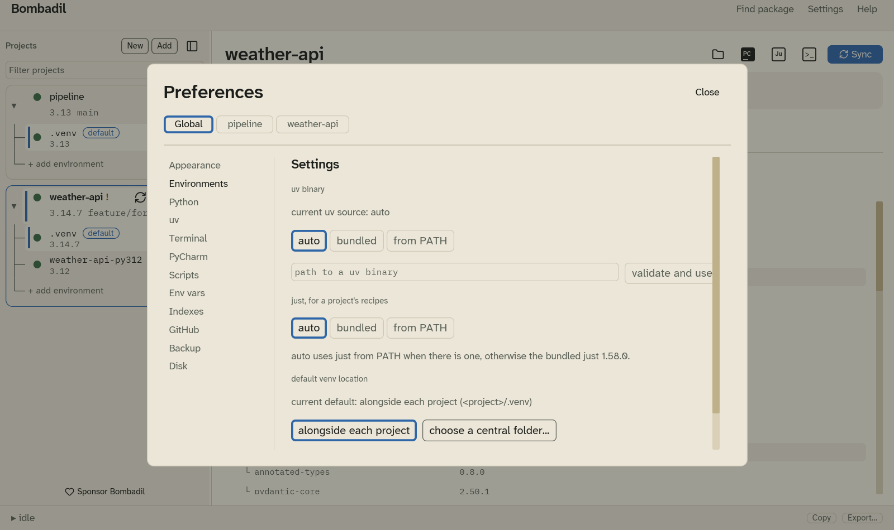
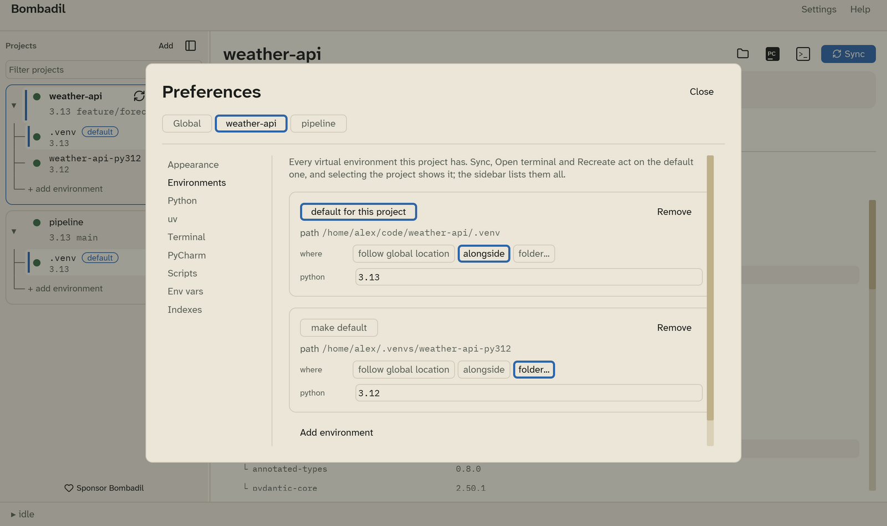
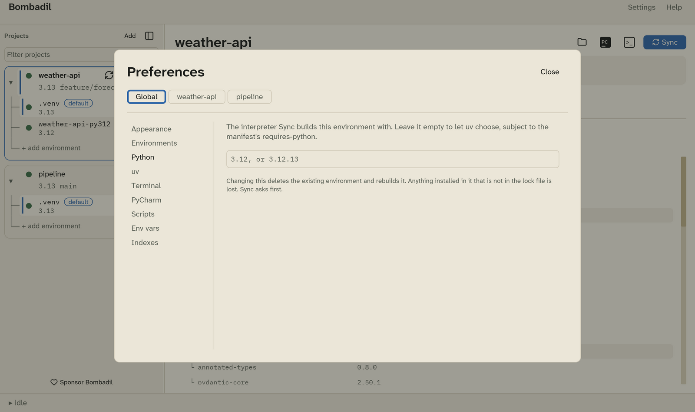
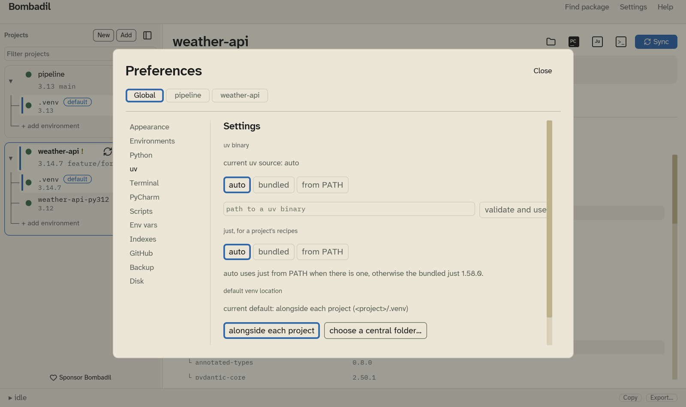
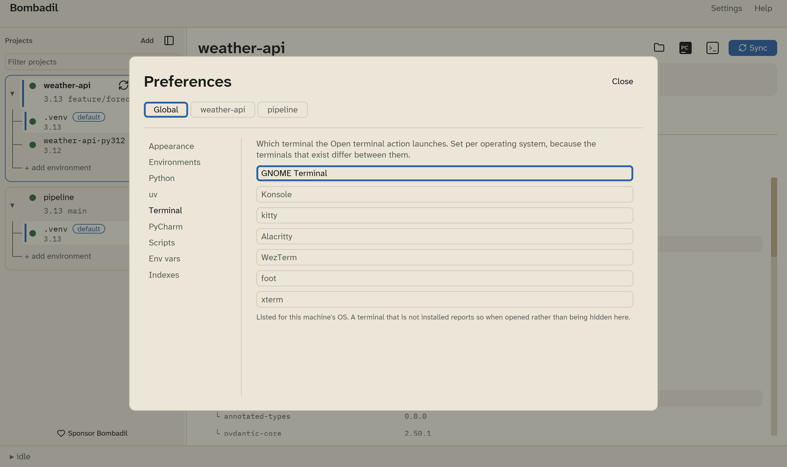
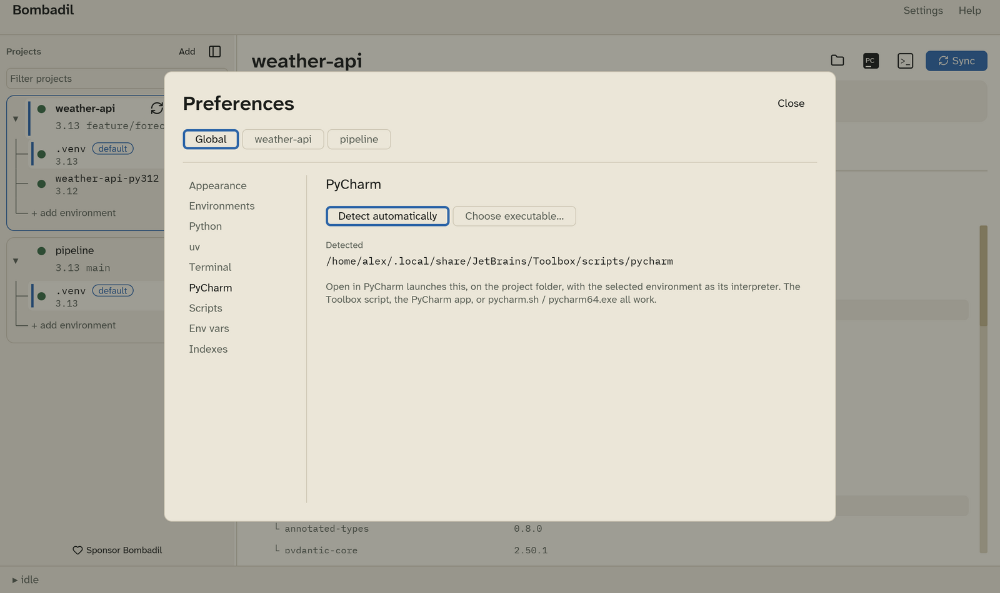
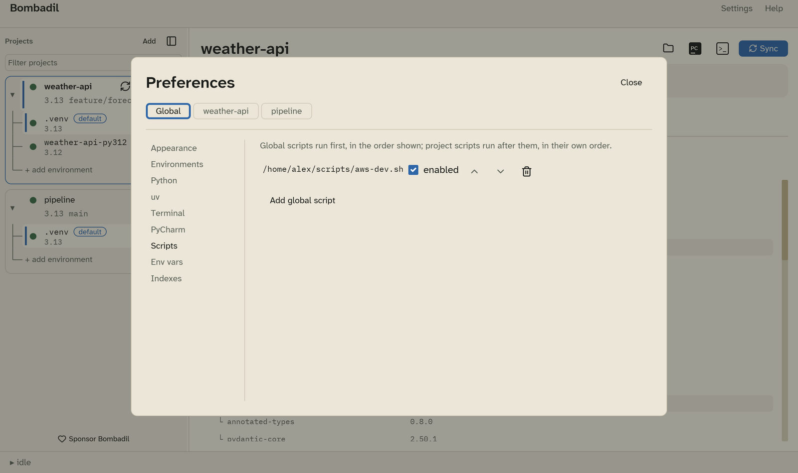
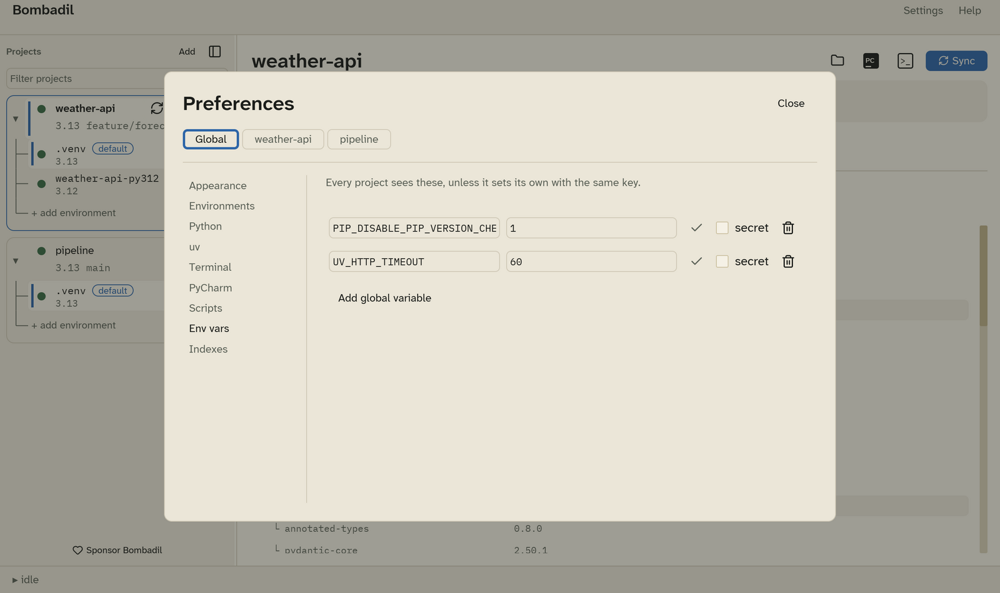
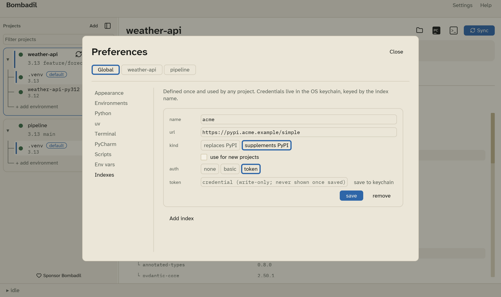

# Settings

Open **Settings** in the menu bar and pick a section. Changes are saved as
you make them. There is no Save button.

## Scope: global or one project

The buttons at the top choose what you are editing:

- **Global**: the defaults every project uses.
- **A project's name**: that project's own settings. Where a setting can be
  overridden, an **Inherit from global** checkbox shows the global value in
  brackets. Change the value to override it, and tick the box to go back to
  the global value.

| Section | Global | Per project |
|---|---|---|
| [Appearance](#appearance) | yes | no (applies to every project) |
| [Environments](#environments) | default location | the project's environments |
| [Python](#python) | default pin for new environments | the default environment's pin |
| [uv](#uv) | yes | yes (auto, bundled or from PATH) |
| [just](#just) | yes | no (applies to every project) |
| [Terminal](#terminal) | yes | yes |
| [PyCharm](#pycharm) | yes | no (applies to every project) |
| [Scripts](#scripts) | global scripts | in the project's Scripts tab |
| [Env vars](#env-vars) | global variables | project variables |
| [Indexes](#indexes) | index definitions | which indexes the project uses |

## Appearance

- **System**, **Light** or **Dark**. **System** follows your desktop's light
  or dark setting, and changes when it changes.
- **Closing the window**: **Keeps Bombadil in the tray** (the default) or
  **Quits**. See [The tray](tray.md).

## Environments

**Global scope** sets where new environments go by default:

- **alongside each project**: `<project>/.venv`. This is the default.
- **choose a central folder…**: every project gets a folder inside one
  directory, named after the project folder plus a short hash of its path,
  for example `~/.venvs/weather-api-3f9a2c`.

**Check installed packages for known vulnerabilities** asks osv.dev about the
installed packages of the project you are looking at, sending their names
and versions. It is on by default; see
[Known vulnerabilities](dependencies.md#known-vulnerabilities).

**Project scope** lists every environment of that project:

- **make default** chooses which environment Sync, Open terminal, Recreate,
  PyCharm and the Dependencies tab act on.
- **where**: **follow global location**, **alongside**, or **folder…** to
  pick any folder.
- **python**: the version this environment is built with, such as `3.12` or
  `3.12.13`. Leave it empty to let uv choose within the project's
  `requires-python`.
- **Remove** takes the environment out of Bombadil. The folder stays on disk.
  The last environment of a project can't be removed.
- **Add environment** adds another one.

!!! warning
    Changing an environment's python deletes it and rebuilds it on the next
    Sync. Bombadil asks before that Sync runs.

## Python

- **Global scope**: the pin new environments start with. Leave it empty to
  let uv choose.
- **Project scope**: the pin of the project's default environment. This is
  the same value as **python** under [Environments](#environments).

Versions are compared segment by segment, so a pin of `3.12` is satisfied by
an environment on `3.12.13`.

## uv

Which uv binary Bombadil runs:

| Choice | Behaviour |
|---|---|
| **auto** (default) | uv from `PATH` if it is version 0.12.1 or newer, otherwise the copy bundled with Bombadil. |
| **bundled** | Always the bundled copy. |
| **from PATH** | Always uv from `PATH`. If there is none, Bombadil shows an error. |
| **path to a uv binary** | A specific binary. Type its path and click **validate and use**. Bombadil runs it to check its version before using it. |

In a project's scope you can override the choice with **auto**, **bundled**
or **from PATH**. Use this for a project that has to stay on a particular uv.
A specific binary can only be set globally, because it is checked before it
is trusted.

### just

Which `just` runs a project's [recipes](running.md#just-recipes). Global
only.

| Choice | Behaviour |
|---|---|
| **auto** (default) | `just` from `PATH` if there is one, otherwise the copy bundled with Bombadil. |
| **bundled** | Always the bundled copy. |
| **from PATH** | Always `just` from `PATH`. If there is none, the Run tab says so. |

## Terminal

The terminal that **Open terminal** launches. The list shows the terminals
for the OS you are running, with a note next to the ones that can't carry the
activated environment. The choice is saved per operating system, so a project
shared between machines can use iTerm2 on macOS and Konsole on Linux. See
[Terminals and PyCharm](terminals-pycharm.md#supported-terminals).

For a terminal that isn't listed, click **Add custom terminal** and give it
a name and a command, for example `tilix --working-directory={cwd} -e
{shell}`. `{cwd}` becomes the project folder and `{shell}` your shell. Click
the name to make it the one **Open terminal** launches. Every custom terminal
also appears in the project menu's **Open terminal** list.

Keep `{shell}` as a word of its own, as in the example. Bombadil then adds the
arguments that put the environment back at the front of `PATH` after your
shell's startup files run. Inside a longer word, such as `--command={shell}`,
the variables still arrive but that last step is skipped.

Custom terminals are saved per operating system, like the choice itself.

## PyCharm

- **Detect automatically** (default): Bombadil looks in the usual install
  locations and on `PATH`, and shows what it found under **Detected**. It looks
  again each time you open this section.
- **Choose executable…**: pick the PyCharm launcher yourself. This can be the
  Toolbox script, the PyCharm app, `pycharm.sh` or `pycharm64.exe`. Bombadil
  launches the file you choose and doesn't detect anything. If the file
  disappears later, **Open in PyCharm** says so instead of opening a different
  PyCharm.

## Scripts

The global [pre-activate scripts](scripts.md), which run for every project
before that project's own scripts. A project's scripts are edited in its
**Scripts** tab.

## Env vars

Global [environment variables and secrets](env-vars.md). In a project's
scope, this shows that project's variables, the same as its **Env vars** tab.

## Indexes

In the global scope, define [package indexes](indexes.md) and save their
credentials to the keychain. In a project's scope, choose which of them the
project uses.

## Disk usage

Global only. Every environment of every project with its size, largest
first, and the total. Sizes are measured each time you open the section.

- **Remove and delete** appears on a project's extra environments. It takes
  the environment out of the project and deletes its folder. A project's
  default environment is never offered.
- **Leftover environments** are folders in your central venv folder (see
  [Environments](#environments)) that no project in Bombadil uses any more,
  for example after you removed a project. **Delete** removes one. A folder
  that is itself a project, or holds one, is never listed.
- **uv cache** shows where uv keeps downloaded packages and its size.
  **Remove unused cache files** runs `uv cache prune`, which removes cache
  entries uv no longer needs, and says how much space it freed. Your
  environments are not touched.

Every delete asks first, and can't be undone. An environment can't be
deleted while its project is running a program or a uv command.
